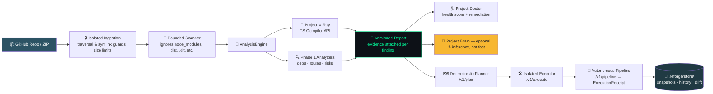
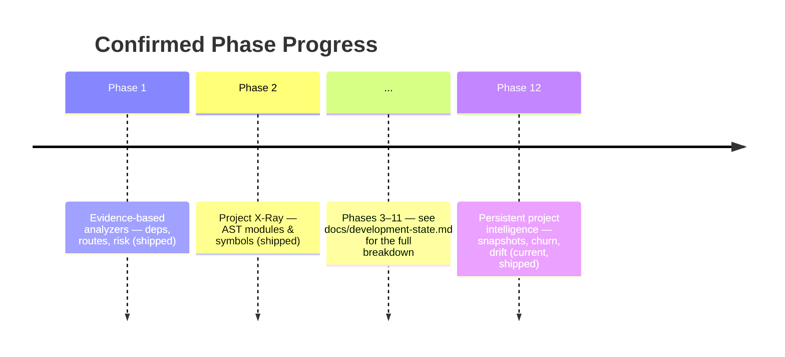

<div align="center">


<a href="https://github.com/Crusty-chirayu/ReForge">
  
</a>

<br/>


</div>

<br/>

> **TL;DR** — ReForge ingests a codebase, runs bounded deterministic static analysis on it (structure, dependencies, risk, health), and hands back a machine-readable, evidence-backed report. An optional AI layer can answer questions *on top of* that report — but it's labeled inference, never treated as ground truth. No LLM is in the loop for the facts.

<br/>

## 🧭 Table of Contents

- [Why ReForge Exists](#-why-reforge-exists)
- [Deterministic vs. AI — the Core Design Bet](#%EF%B8%8F-deterministic-vs-ai--the-core-design-bet)
- [Current Capabilities](#-current-capabilities)
- [Architecture](#-architecture)
- [Example: What a Report Looks Like](#-example-what-a-report-looks-like)
- [API Surface](#-api-surface)
- [Install, Run, Test](#-install-run-test)
- [Project Structure](#-project-structure)
- [Build Status & Roadmap](#-build-status--roadmap)
- [Known Limitations (stated plainly)](#-known-limitations-stated-plainly)
- [AI Agent Handoff Protocol](#-ai-agent-handoff-protocol)
- [Maintainer](#-maintainer)
- [License](#-license)

<br/>

## 💡 Why ReForge Exists

Point a generic AI coding assistant at an unfamiliar codebase and it will happily summarize it in fluent natural language — with no way to tell you which claims are verified facts and which are plausible-sounding guesses. That gap is where bugs, bad refactors, and wasted review cycles come from.

ReForge inverts the order of operations: **static analysis first, AI second.** It parses the project, extracts real dependency graphs, detects routes, and scores risk — all without a language model — and keeps the file-level evidence attached to every finding. The AI layer (**Project Brain**) only ever sees that deterministic report; it can reason over it, but it can't override it.

<br/>

## ⚖️ Deterministic vs. AI — the Core Design Bet

<div align="center">

| Capability | Deterministic Engine | AI-Assisted |
|---|:---:|:---:|
| Project structure / X-Ray (AST-based) | ✅ | — |
| Dependency analysis (manifest-derived) | ✅ | — |
| Route & risk detection (pattern-based) | ✅ | — |
| Project Doctor findings + health score | ✅ | — |
| Deterministic planning (`/v1/plan`) | ✅ | — |
| Natural-language Q&A (`/v1/brain/query`) | — | ✅ *(requires provider · `503` without one · marked inference)* |

</div>

<br/>

## 🚀 Current Capabilities

<table>
<tr>
<td width="50%" valign="top">

**📥 Safe Ingestion**
- Public HTTPS GitHub repo or ZIP archive
- ZIP path-traversal & symlink rejection
- Enforced archive/extraction size & entry limits
- Local-path ingestion exists but is **disabled by default** — opt-in only

**🔬 Static Analysis**
- Language, framework, manifest-dependency detection
- Entry points, licenses, copyright notices
- Evidence-backed basic risk indicators
- Ignores `.git`, `node_modules`, `dist`, `build`, `coverage`, `.next`, `.cache`, `vendor`, binaries, oversized files

**🩻 Project X-Ray** *(TS / JS / JSON)*
- AST-derived modules & symbols via the TypeScript compiler API
- Imports/exports, resolved internal relationships
- External imports + prod/dev/peer dependency split
- Line/file metrics

</td>
<td width="50%" valign="top">

**🩺 Project Doctor**
- Large-file/module, duplicate-import, coupling/cycle, missing-test, dependency-count, hardcoded-secret indicators
- Remediation guidance per finding
- Heuristic health score: `100 − min(100, Σ severityWeight × confidenceWeight)`

**🧠 Project Brain** *(optional)*
- Provider-agnostic, stateless Q&A over the deterministic report
- Explicitly labeled inference — never a source of truth
- Safe `503` when no provider is configured

**⚙️ Planning & Autonomous Pipeline**
- Deterministic plans: priorities, dependencies, risks, acceptance criteria (`/v1/plan`)
- Trusted-ZIP patch execution in a disposable, re-hashed workspace (`/v1/execute`)
- End-to-end pipeline: ingest → X-Ray → Doctor → plan → patch → execute → receipt (`/v1/pipeline`)
- Persisted snapshots, comparisons, churn, and drift detection in `.reforge/store/`

</td>
</tr>
</table>

<br/>

## 🏗 Architecture



`HTTP API → ingestion → isolated workspace → scanner → modular analyzers → versioned report`

- `AnalysisEngine` orchestrates every analyzer over one shared scan result.
- Static facts and AI inference are **architecturally separated by design**, not just by convention.
- Deep dives: [`docs/architecture.md`](https://github.com/Crusty-chirayu/ReForge/blob/main/docs/architecture.md) · [`docs/decisions.md`](https://github.com/Crusty-chirayu/ReForge/blob/main/docs/decisions.md)

<br/>

## 🧪 Example: What a Report Looks Like

<sub>Illustrative shape only — not captured live output. Run `/v1/analyze/repository` to see the real thing.</sub>

```jsonc
{
  "report": {
    "language": "TypeScript",
    "framework": "Fastify",
    "healthScore": 78,
    "findings": [
      {
        "type": "missing-test",
        "file": "src/xray-analyzer.ts",
        "severity": "medium",
        "confidence": 0.9,
        "evidence": "No corresponding *.test.ts found under test/",
        "remediation": "Add unit coverage for exported symbols in xray-analyzer.ts"
      }
    ],
    "brain": {
      "answer": "This module likely handles AST parsing based on its imports.",
      "sourceType": "inference",       // ⚠️ never treated as fact
      "groundedIn": "report.findings[*]"
    }
  }
}
```

<br/>

## 🔌 API Surface

| Method | Endpoint | Purpose |
|---|---|---|
| `GET` | `/health` | Service health check |
| `POST` | `/v1/analyze/archive` | Analyze a multipart ZIP field named `archive` |
| `POST` | `/v1/analyze/repository` | Analyze a public HTTPS GitHub repository URL |
| `POST` | `/v1/snapshot` | Ingest a ZIP → compact execution snapshot |
| `POST` | `/v1/execute` | Apply approved patches inside a disposable workspace → `ExecutionReceipt` |
| `POST` | `/v1/execute/validate` | Validate snapshot-bound patches without applying them |
| `POST` | `/v1/pipeline` | Run the full autonomous engineering pipeline |
| `GET` | `/v1/pipeline/history` | List recent pipeline executions (`?limit=`) |
| `GET` | `/v1/pipeline/:pipelineId` | Full execution receipt for a recorded run |
| `GET` | `/v1/snapshot/:snapshotId` | Stored snapshot metadata |
| `GET` | `/v1/snapshots/:beforeId/compare/:afterId` | Deterministic snapshot comparison |
| `GET` | `/v1/snapshot/:snapshotId/intelligence` | Change frequency, churn, architecture drift |
| `GET` | `/v1/project/history` | Historical project snapshot timeline |
| `POST` | `/v1/analyze/local` | 🔒 Dev-only — requires `REFORGE_ENABLE_LOCAL_INGESTION=true` |

```bash
curl.exe -F "archive=@C:\path\project.zip" http://127.0.0.1:3000/v1/analyze/archive

Invoke-RestMethod -Method Post http://127.0.0.1:3000/v1/analyze/repository `
  -ContentType application/json `
  -Body '{"repositoryUrl":"https://github.com/owner/repository.git"}'
```

<br/>

## ⚡ Install, Run, Test

```bash
git clone https://github.com/Crusty-chirayu/ReForge.git
cd ReForge
pnpm install
pnpm start
# → http://127.0.0.1:3000
```

```bash
# Type-check
node ./node_modules/typescript/bin/tsc --noEmit

# Run tests
node ./node_modules/tsx/dist/cli.mjs --test test/*.test.ts
```

<sub>Windows paths: `.\node_modules\typescript\bin\tsc`, `.\node_modules\tsx\dist\cli.mjs`</sub>

<br/>

## 📁 Project Structure

```
ReForge/
├── src/
│   ├── ingestion.ts       # workspace, Git, upload & safe ZIP handling
│   ├── scanner.ts         # bounded relevant-file scan
│   ├── analyzers.ts       # Phase 1 — evidence-based analyzers
│   ├── xray-analyzer.ts   # Phase 2 — Project X-Ray (AST + model)
│   ├── engine.ts          # report orchestration
│   └── server.ts          # Fastify transport
├── test/                  # unit + fixture tests
├── docs/                  # architecture, decisions, state, roadmap
├── pnpm-workspace.yaml
├── tsconfig.json
└── package.json
```

<sub>No `frontend/` yet — ReForge is currently an HTTP API with no bundled UI.</sub>

<br/>

## 📊 Build Status & Roadmap

> Development is ongoing but paced around other commitments — expect steady, not constant, progress. Check other branches for in-flight agent/pipelining work.



**⚠️ Known documentation discrepancy, stated here transparently:** the repo's own docs mark Phase 12 as the current completed phase, while `docs/roadmap.md` separately names **Phase 3 — Project Doctor** as the next milestone. That's a pre-existing inconsistency in the source repo, not something introduced by this README — treat [`docs/roadmap.md`](https://github.com/Crusty-chirayu/ReForge/blob/main/docs/roadmap.md) as the source of truth to reconcile before planning new work.

### 🔭 Where this could go next
- [ ] Frontend / dashboard for report visualization (none exists yet)
- [ ] Path aliases, package export maps, and monorepo-aware module resolution
- [ ] Parser support beyond TS/JS/JSON
- [ ] Sandboxed/isolated Git worker before exposure to untrusted production traffic
- [ ] Security scanner + vulnerability-advisory lookups for Doctor
- [ ] Test-coverage-aware health scoring (currently static-only)
- [ ] Authentication layer + private-repository connector
- [ ] Job queue for long-running analyses instead of synchronous requests

<br/>

## 🎯 Known Limitations (stated plainly)

- Parser support: **TypeScript / JavaScript / JSON only**, for now.
- Route detection covers a bounded set of common patterns — no dynamic-route inference, no code execution.
- Module resolution doesn't yet handle TS path aliases, export maps, or monorepo workspaces.
- No UI, database, job queue, auth, private-repo connector, security scanner, performance analyzer, or code generation — yet.
- Git cloning should be sandboxed before this is exposed to untrusted production workloads.
- Project Doctor is static-only: no runtime profiling, no coverage measurement, no advisory lookups.

<br/>

## 🤖 AI Agent Handoff Protocol

If you're an AI agent picking this repo up:

1. Read this README, then `docs/development-state.md` → `docs/architecture.md` → `docs/roadmap.md` → `docs/decisions.md`, in that order.
2. Inspect existing source and tests before touching anything.
3. **Do not rebuild completed phases.** Continue from current Git state.
4. Preserve the evidence-first architecture — static facts stay separate from AI inference, always.
5. Do not start future phases without explicit instruction.

<br/>

## 🧑‍💻 Maintainer

<div align="center">
<a href="https://github.com/Crusty-chirayu">

<br/><sub><b>Chirayu</b></sub>
</a>
<br/>
<sub>Owner & sole maintainer — architecture, backend, and everything between ingestion and receipt.</sub>
<br/><br/>
<a href="https://github.com/Crusty-chirayu"></a>
</div>

<br/>

<div align="center">

### ⭐ Star History

<a href="https://star-history.com/#Crusty-chirayu/ReForge&Date">
  
</a>

</div>

<br/>

## 📄 License

Not licensed till date (Will be done soon during the Continuation starts) 

<br/>
<div align="center">

*Evidence over eloquence.*
</div>
