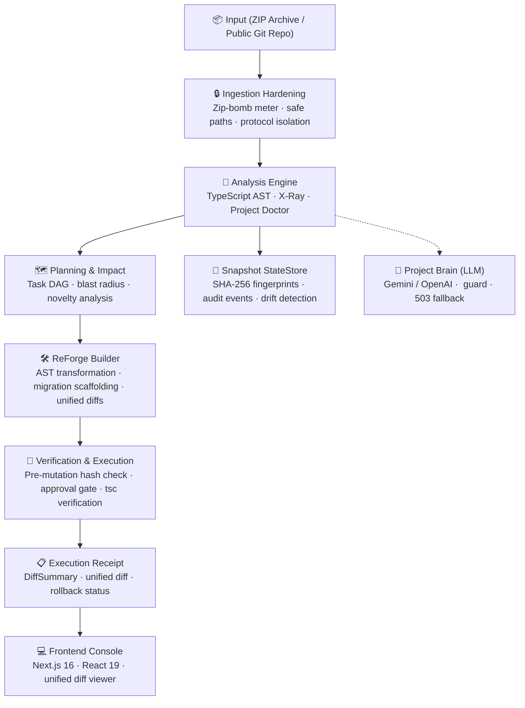

<div align="center">


<a href="https://github.com/Crusty-chirayu/ReForge">
  
</a>

<br/>


</div>

<br/>

> **TL;DR** — ReForge is an AI Engineering Intelligence Platform. It ingests codebases, performs bounded deterministic static analysis (AST structure, dependencies, architecture, doctor health), creates dependency-aware engineering plans, synthesizes valid code patches with unified diff previews, safely executes approved changes inside isolated disposable workspaces, and verifies results via typecheckers and test runners. An optional AI layer (**Project Brain**) connects to Google Gemini or OpenAI-compatible backends to provide grounded inference over deterministic facts—never fabricating answers when unconfigured.

<br/>

## 🧭 Table of Contents

- [Why ReForge Exists](#-why-reforge-exists)
- [Deterministic vs. AI — Core System Invariant](#%EF%B8%8F-deterministic-vs-ai--core-system-invariant)
- [System Architecture](#-system-architecture)
- [Capabilities Breakdown](#-capabilities-breakdown)
- [API Surface](#-api-surface)
- [AI Provider Configuration](#-ai-provider-configuration)
- [Monorepo Workspace & Getting Started](#-monorepo-workspace--getting-started)
- [Testing & Quality Verification](#-testing--quality-verification)
- [Maintainer](#-maintainer)
- [License](#-license)

<br/>

## 💡 Why ReForge Exists

Generic AI coding assistants frequently hallucinate project structures, invent non-existent APIs, and propose unverified code patches without knowing whether they break existing contracts.

ReForge strictly separates **deterministic truth** from **AI inference**:

1. **Deterministic Static Analysis First**: Real AST parsing (TypeScript Compiler API), manifest-derived dependencies, circular dependency analysis, and Doctor health scoring are 100% deterministic and traceable to concrete file evidence.
2. **Grounded AI Reasoning Second**: Project Brain answers questions strictly conditioned on verified report evidence inside anti-prompt-injection boundary tags (`<project_context>`). It marks inferences explicitly and refuses to hallucinate facts.
3. **Controlled Code Transformation**: The Builder generates syntactically valid code changes (including AST-based duplicate import consolidation and migration scaffolding), computes unified diffs (`--- a/... +++ b/...`), requires human approval, and verifies outcomes inside isolated workspaces with atomic rollback.

<br/>

## ⚖️ Deterministic vs. AI — Core System Invariant

<div align="center">

| Capability | Engine Type | Behavior & Safeguards |
|---|:---:|---|
| Project X-Ray (AST Model) | Deterministic | AST parsing of symbols, imports, exports, and relationships via TypeScript API |
| Dependency Analysis | Deterministic | Production, dev, and peer manifest audit with version extraction |
| Project Doctor Health Audit | Deterministic | Rules `CQ-001` through `CQ-006` with deterministic penalty scoring |
| Change Impact Analysis | Deterministic | Blast radius calculation, fan-in/fan-out graph traversal, affected modules |
| Engineering Planner | Deterministic | Directed acyclic graph (DAG) of tasks with dependencies and risks |
| Code Patch Synthesis | AST / Hybrid | Syntactically valid transformations, import deduplication, unified diff generation |
| Isolated Execution & Verification | Deterministic | Hash validation, path containment, `shell=false` process execution, atomic rollback |
| Project Brain | Real AI Provider | Google Gemini / OpenAI REST backend (`503` when unconfigured; never fakes answers) |

</div>

<br/>

## 🏗 System Architecture



<br/>

## 🚀 Capabilities Breakdown

### 📥 Ingestion & Workspace Isolation
- **ZIP Bomb Metering**: Enforces 100 MB single-file, 500 MB total extraction, and 200 MB archive payload limits via Node.js Transform streams.
- **Path Traversal Defenses**: Detects and rejects directory traversal (`..`), absolute POSIX/Windows paths, null bytes, and drive letters before file write.
- **Git Hardening**: Submodule recursion disabled, external protocols blocked (`protocol.file.allow=never`, `protocol.ext.allow=never`, `credential.helper=`).
- **Host Workspace Protection**: Host repository `E:\projects\ReForge` is never touched by analysis or execution operations.

### 🩻 Project X-Ray & Doctor
- Full AST-based module graph: extracts symbols, exported interfaces, external packages, and module dependency chains.
- Doctor diagnostic rules detect high coupling, duplicate imports (`CQ-003`), missing test coverage, secret patterns, and circular dependencies.

### 🛠️ Builder & Code Transformation Engine
- **AST Deduplication**: Automatically consolidates redundant import statements targeting the same specifier.
- **Migration Generation**: Scaffolds reversible database migration templates with typed `up()` and `down()` handlers.
- **Non-Destructive Augmentation**: Preserves existing module contracts and verifies syntax via `ts.createSourceFile`.
- **Unified Diff Generation**: Implements Myers-style line diffing to generate standard POSIX / Git unified diffs (`diffSummary.unifiedDiff`).

### 🧠 Project Brain (Real AI Provider)
- Connects to Google Gemini (`gemini-1.5-flash`, `gemini-2.0-flash`, etc.) or OpenAI-compatible backends.
- Hardened prompt-injection defense with `<project_context>` tags.
- Honest unconfigured state: returns HTTP 503 and clear UI alert when no API key is provided, never faking AI responses.

<br/>

## 🔌 API Surface

| Method | Endpoint | Description |
|---|---|---|
| `GET` | `/health` | Service health status |
| `GET` | `/v1/brain/status` | Current AI provider status, model name, and configuration state |
| `POST` | `/v1/brain/query` | Grounded Q&A against deterministic project context |
| `POST` | `/v1/analyze/archive` | Analyze multipart ZIP archive |
| `POST` | `/v1/analyze/repository` | Ingest and analyze public Git repository |
| `POST` | `/v1/plan` | Generate deterministic engineering plan |
| `POST` | `/v1/impact` | Evaluate change impact and blast radius |
| `POST` | `/v1/novelty` | Compute architectural novelty score |
| `POST` | `/v1/build` | Generate proposed BuildPlan |
| `POST` | `/v1/snapshot` | Ingest project to SHA-256 snapshot |
| `POST` | `/v1/execute` | Safely apply approved patches inside isolated disposable workspace |
| `POST` | `/v1/execute/validate` | Validate patch boundaries without disk mutation |
| `POST` | `/v1/pipeline` | Run autonomous end-to-end pipeline (analyze → plan → patch → execute → verify) |
| `GET` | `/v1/pipeline/history` | List recent pipeline execution records |
| `GET` | `/v1/pipeline/:pipelineId` | Fetch full execution receipt and unified diff |
| `GET` | `/v1/snapshot/:snapshotId` | Fetch stored snapshot metadata |
| `GET` | `/v1/snapshots/:beforeId/compare/:afterId` | Compare two snapshots for additions, deletions, renames, and drift |
| `GET` | `/v1/snapshot/:snapshotId/intelligence` | Historical churn frequency and architecture drift |
| `GET` | `/v1/project/history` | Chronological snapshot timeline |

<br/>

## 🔑 AI Provider Configuration

ReForge supports Google Gemini and OpenAI-compatible LLM backends:

```bash
# Option 1: Google Gemini (recommended)
export GEMINI_API_KEY="your-gemini-api-key"
export REFORGE_LLM_PROVIDER="gemini"
export REFORGE_LLM_MODEL="gemini-1.5-flash"

# Option 2: OpenAI or OpenAI-compatible (Ollama, Groq, OpenRouter, vLLM)
export OPENAI_API_KEY="your-openai-api-key"
export REFORGE_LLM_PROVIDER="openai"
export OPENAI_BASE_URL="https://api.openai.com/v1"
export REFORGE_LLM_MODEL="gpt-4o-mini"
```

If neither key is supplied, ReForge runs completely deterministically. Project Brain safely returns HTTP 503 indicating the provider is unconfigured.

<br/>

## 💻 Monorepo Workspace & Getting Started

ReForge is organized as a pnpm monorepo consisting of the Fastify backend engine and the Next.js 16 frontend console.

### Prerequisites
- Node.js >= 20.9.0
- pnpm >= 9.0.0

```bash
# Clone the repository
git clone https://github.com/Crusty-chirayu/ReForge.git
cd ReForge

# Install dependencies across all packages
pnpm install

# Start backend engine (port 3000)
pnpm start

# In a separate terminal, start frontend console (port 3001)
pnpm --filter reforge-frontend dev
```

Visit `http://localhost:3001` to access the ReForge Engineering Intelligence Console.

<br/>

## 🧪 Testing & Quality Verification

ReForge features an exhaustive automated test suite with **433 tests across both stacks**:

```bash
# Run backend test suite (113 tests across 20 suites)
pnpm test

# Run backend typecheck
pnpm check

# Run frontend Vitest suite (320 tests across 25 suites)
pnpm test:frontend

# Run frontend typecheck
pnpm check:frontend

# Build frontend production bundle (Next.js Turbopack)
pnpm build:frontend
```

<br/>

## 🧑‍💻 Maintainer

<div align="center">
<a href="https://github.com/Crusty-chirayu">

<br/><sub><b>Chirayu</b></sub>
</a>
<br/>
<sub>Architecture, backend systems, and engineering intelligence.</sub>
<br/><br/>
<a href="https://github.com/Crusty-chirayu"></a>
</div>

<br/>

## 📄 License

MIT License. See [LICENSE](LICENSE) for details.

<div align="center">

*Evidence over eloquence.*
</div>
