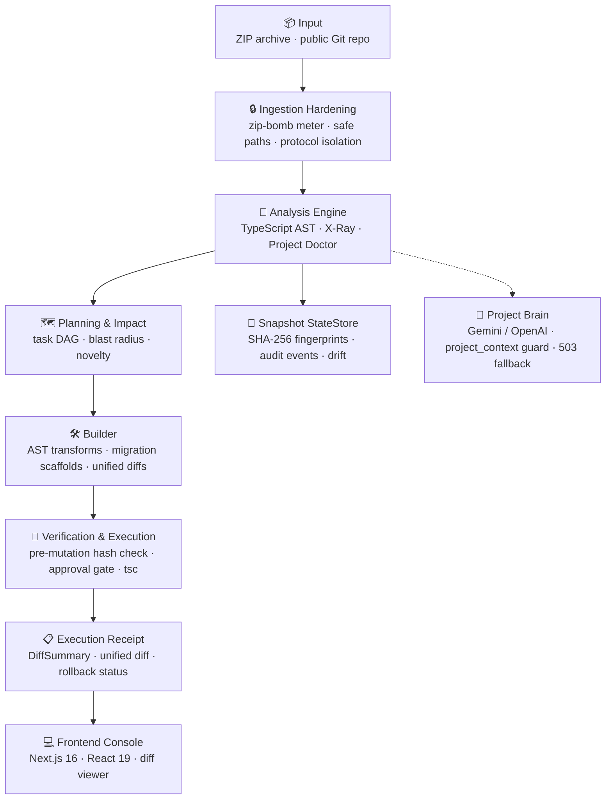

<div align="center">


<a href="https://github.com/Crusty-chirayu/ReForge">
  
</a>

<br/>


**[Why](#-why-reforge-exists) · [Invariant](#%EF%B8%8F-the-core-invariant) · [Architecture](#-architecture) · [Capabilities](#-capabilities) · [API](#-api-surface) · [Quick Start](#-quick-start) · [Roadmap](#-status--roadmap)**

<br/>



</div>

<br/>

> **TL;DR** — ReForge ingests a codebase, runs bounded **deterministic** static analysis (AST structure, dependencies, architecture, health), builds a dependency-aware engineering plan, synthesizes valid patches with **unified diff previews**, executes *approved* changes inside **isolated disposable workspaces**, and verifies the result with typecheckers and test runners. An optional AI layer, **Project Brain**, reasons over the deterministic facts through Gemini or any OpenAI-compatible backend, and refuses to answer when it is not configured.

---

## 💡 Why ReForge Exists

Generic AI coding assistants hallucinate project structure, invent APIs, and propose patches without knowing what they will break.

ReForge flips the order of operations:

| | Principle | What it means |
|---|---|---|
| **1** | **Facts first** | Real AST parsing via the TypeScript Compiler API, manifest-derived dependencies, circular-dependency analysis, and Doctor scoring. Every finding traces to concrete file evidence. |
| **2** | **Grounded AI second** | Project Brain answers *only* from verified report evidence, fenced inside `<project_context>` boundary tags against prompt injection. Inferences are marked as inferences. |
| **3** | **Controlled change** | Builder produces syntactically valid patches, computes unified diffs, waits for human approval, verifies in isolation, and rolls back atomically. |

---

## ⚖️ The Core Invariant

<div align="center">

**Proposal ≠ Approval ≠ Execution ≠ Verification**

</div>

| Capability | Engine | Safeguards |
|---|---|---|
| 🩻 Project X-Ray | Deterministic | AST parsing of symbols, imports, exports and relationships via the TypeScript API |
| 📦 Dependency Analysis | Deterministic | Production, dev and peer manifest audit with version extraction |
| 🩺 Project Doctor | Deterministic | Rules `CQ-001` → `CQ-006` with deterministic penalty scoring |
| 💥 Change Impact | Deterministic | Blast radius, fan-in / fan-out traversal, affected modules |
| 🗺️ Engineering Planner | Deterministic | DAG of tasks with dependencies and risks |
| 🛠️ Patch Synthesis | AST / Hybrid | Valid transformations, import dedup, unified diff generation |
| 🚦 Execution & Verification | Deterministic | Hash validation, path containment, `shell=false` execution, atomic rollback |
| 🧠 Project Brain | **Real AI provider** | Gemini / OpenAI REST. `503` when unconfigured, never a faked answer |

---

## 🏗 Architecture



---

## 🚀 Capabilities

<details open>
<summary><b>📥 Ingestion & Workspace Isolation</b></summary>
<br/>

- **Zip-bomb metering** via Node.js Transform streams: 100 MB per file, 500 MB total extraction, 200 MB archive payload.
- **Path-traversal defenses**: rejects `..`, absolute POSIX/Windows paths, null bytes and drive letters *before* any write.
- **Git hardening**: submodule recursion disabled, `protocol.file.allow=never`, `protocol.ext.allow=never`, `credential.helper=` cleared.
- **Host protection**: the host repository is never touched by analysis or execution.

</details>

<details open>
<summary><b>🩻 Project X-Ray & 🩺 Doctor</b></summary>
<br/>

- Full AST module graph: symbols, exported interfaces, external packages, module dependency chains.
- Doctor rules detect high coupling, duplicate imports (`CQ-003`), missing test coverage, secret patterns and circular dependencies.

</details>

<details open>
<summary><b>🛠️ Builder & Transformation Engine</b></summary>
<br/>

- **AST deduplication** consolidates redundant imports targeting the same specifier.
- **Migration generation** scaffolds reversible templates with typed `up()` / `down()` handlers.
- **Non-destructive augmentation** preserves module contracts and validates syntax with `ts.createSourceFile`.
- **Unified diffs** via Myers-style line diffing, standard POSIX / Git format (`diffSummary.unifiedDiff`).

</details>

<details open>
<summary><b>🧠 Project Brain</b></summary>
<br/>

- Google Gemini (`gemini-1.5-flash`, `gemini-2.0-flash`, …) or OpenAI-compatible backends (Ollama, Groq, OpenRouter, vLLM).
- Prompt-injection hardening with `<project_context>` tags.
- **Honest unconfigured state**: HTTP `503` plus a clear UI alert. No key, no fake answers.

</details>

<details>
<summary><b>📸 Snapshots & Historical Intelligence</b></summary>
<br/>

- SHA-256 fingerprinted snapshots with audit events.
- Compare any two snapshots for additions, deletions, renames and drift.
- Churn frequency and architecture drift per snapshot, plus a chronological project timeline.

</details>

---

## 🔌 API Surface

<details>
<summary><b>19 endpoints — click to expand</b></summary>
<br/>

| Method | Endpoint | Description |
|:--:|---|---|
| `GET` | `/health` | Service health |
| `GET` | `/v1/brain/status` | AI provider status, model, configuration state |
| `POST` | `/v1/brain/query` | Grounded Q&A against deterministic context |
| `POST` | `/v1/analyze/archive` | Analyze a multipart ZIP |
| `POST` | `/v1/analyze/repository` | Ingest and analyze a public Git repo |
| `POST` | `/v1/plan` | Deterministic engineering plan |
| `POST` | `/v1/impact` | Change impact and blast radius |
| `POST` | `/v1/novelty` | Architectural novelty score |
| `POST` | `/v1/build` | Generate a proposed BuildPlan |
| `POST` | `/v1/snapshot` | Ingest a project into a SHA-256 snapshot |
| `POST` | `/v1/execute` | Apply approved patches in an isolated workspace |
| `POST` | `/v1/execute/validate` | Validate patch boundaries with no disk mutation |
| `POST` | `/v1/pipeline` | End-to-end: analyze → plan → patch → execute → verify |
| `GET` | `/v1/pipeline/history` | Recent pipeline records |
| `GET` | `/v1/pipeline/:pipelineId` | Full receipt and unified diff |
| `GET` | `/v1/snapshot/:snapshotId` | Stored snapshot metadata |
| `GET` | `/v1/snapshots/:beforeId/compare/:afterId` | Snapshot comparison |
| `GET` | `/v1/snapshot/:snapshotId/intelligence` | Churn and architecture drift |
| `GET` | `/v1/project/history` | Chronological snapshot timeline |

</details>

---

## ⚡ Quick Start

**Prerequisites:** Node.js ≥ 20.9.0 · pnpm ≥ 9.0.0

```bash
git clone https://github.com/Crusty-chirayu/ReForge.git
cd ReForge
pnpm install

pnpm start                                # backend engine  → :3000
pnpm --filter reforge-frontend dev        # frontend console → :3001
```

Open **http://localhost:3001**.

### 🔑 Enable Project Brain (optional)

```bash
# Google Gemini
export GEMINI_API_KEY="your-key"
export REFORGE_LLM_PROVIDER="gemini"
export REFORGE_LLM_MODEL="gemini-1.5-flash"

# …or OpenAI-compatible (Ollama, Groq, OpenRouter, vLLM)
export OPENAI_API_KEY="your-key"
export REFORGE_LLM_PROVIDER="openai"
export OPENAI_BASE_URL="https://api.openai.com/v1"
export REFORGE_LLM_MODEL="gpt-4o-mini"
```

No key? ReForge runs fully deterministically and Brain returns `503`.

---

## 🧪 Quality

**433 automated tests** across both stacks.

| Scope | Command | Result |
|---|---|---|
| Backend tests | `pnpm test` | 113 tests · 20 suites |
| Backend typecheck | `pnpm check` | — |
| Frontend tests (Vitest) | `pnpm test:frontend` | 320 tests · 25 suites |
| Frontend typecheck | `pnpm check:frontend` | — |
| Frontend build (Turbopack) | `pnpm build:frontend` | — |

E2E coverage runs on Playwright (`e2e/`).

---

## 🧭 Status & Roadmap

- [x] Hardened ingestion (ZIP + public Git)
- [x] AST X-Ray and Doctor rules `CQ-001`–`CQ-006`
- [x] Planner, Impact and Novelty analysis
- [x] Builder with unified diffs and isolated execution
- [x] Snapshots, comparison, churn and drift intelligence
- [x] Project Brain with honest `503` fallback
- [x] Next.js 16 / React 19 console
- [ ] 🚧 Autonomous agent and pipelining work *(in-flight on feature branches)*
- [ ] 🚧 Console redesign: State Rail, X-Ray views, Builder review workspace

---

## 🧑‍💻 Maintainer

<a href="https://github.com/Crusty-chirayu">
  
</a>

**Chirayu** — architecture, backend systems, and engineering intelligence.<br/>
[](https://github.com/Crusty-chirayu)

<br clear="left"/>

## 📄 License

MIT. See [LICENSE](LICENSE).

<div align="center">


*Evidence over eloquence.*

</div>
