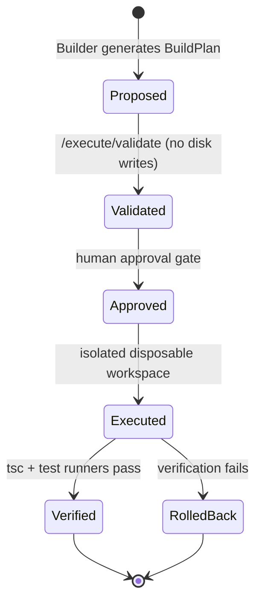
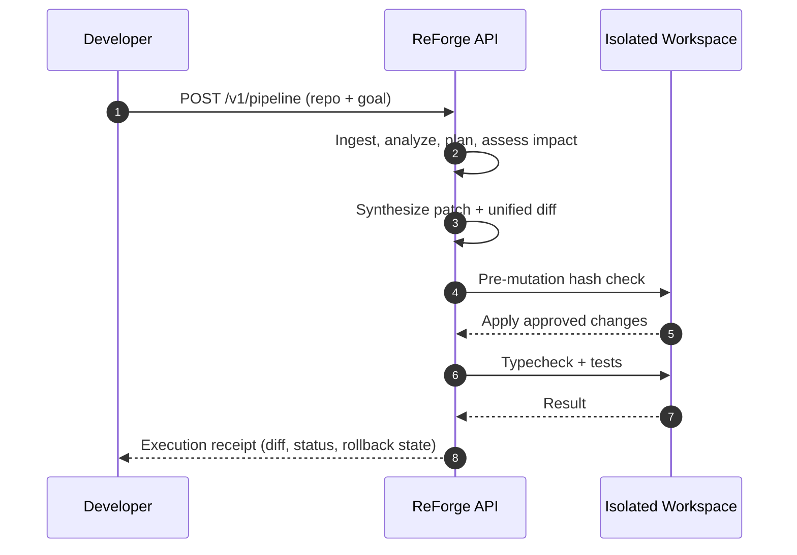
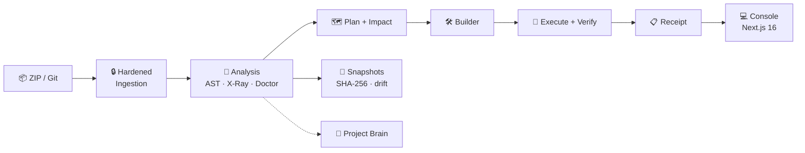

<div align="center">


### The engineering intelligence platform that reads your codebase as a *system*, not a pile of files.

<a href="https://github.com/Crusty-chirayu/ReForge">
  
</a>

<br/><br/>


<br/>


<br/>

**[The Problem](#-the-problem) · [The Idea](#-the-idea) · [Lifecycle](#-the-life-of-a-change) · [Architecture](#-architecture) · [Features](#-features) · [Security](#-security-model) · [API](#-api) · [Quick Start](#-quick-start) · [Roadmap](#-roadmap)**

</div>

---

## 🔥 The Problem

AI coding tools are fast, but they guess. They invent files, hallucinate APIs, and hand you patches with no proof they won't break anything.

**ReForge is built on the opposite bet:** compute the truth first, let AI reason over it second, and never apply a change a human hasn't approved.

|  | Typical AI assistant | **ReForge** |
|---|---|---|
| Understands your repo | Reads snippets, infers the rest | Parses real ASTs, builds a module graph |
| Findings | Opinions | Rule-based, traceable to file evidence |
| Unconfigured AI | Often bluffs | Returns `503`. Never fakes an answer |
| Changes | Applied or pasted blindly | Diff preview → approval → isolated execution → typecheck |
| If it goes wrong | Your problem | Atomic rollback |

---

## 🧬 The Idea

<div align="center">

### `Proposal  ≠  Approval  ≠  Execution  ≠  Verification`

</div>

Four states, never conflated. A proposal is only a proposal until a human approves it, and a change is only "done" once verification has actually passed.

| Layer | Engine | What it guarantees |
|---|---|---|
| 🩻 **X-Ray** | Deterministic | Symbols, imports, exports and relationships from the TypeScript Compiler API |
| 📦 **Dependencies** | Deterministic | Prod / dev / peer manifest audit with versions |
| 🩺 **Doctor** | Deterministic | Rules `CQ-001`–`CQ-006`, deterministic penalty scoring |
| 💥 **Impact** | Deterministic | Blast radius via fan-in / fan-out traversal |
| 🗺️ **Planner** | Deterministic | Task DAG with dependencies and risks |
| 🛠️ **Builder** | AST / hybrid | Valid transforms, unified diffs |
| 🚦 **Executor** | Deterministic | Hash checks, path containment, `shell=false`, rollback |
| 🧠 **Brain** | Real AI provider | Grounded in report evidence, inferences labelled |

---

## 🔁 The Life of a Change





---

## 🏗 Architecture



**Repository layout**

| Path | Purpose |
|---|---|
| `src/` | Fastify backend engine |
| `frontend/` | Next.js 16 / React 19 console |
| `test/` | Backend test suites |
| `e2e/` | Playwright end-to-end tests |
| `docs/` | Documentation |
| `.github/workflows/` | CI |

---

## ✨ Features

<details open>
<summary><b>🩻 X-Ray &amp; 🩺 Doctor: see what's really there</b></summary>

- Full AST module graph: symbols, exported interfaces, external packages, dependency chains.
- Doctor flags high coupling, duplicate imports (`CQ-003`), missing test coverage, secret patterns and circular dependencies.

</details>

<details open>
<summary><b>🗺️ Planning &amp; 💥 Impact: know before you touch</b></summary>

- Dependency-aware task DAG with risks.
- Blast-radius calculation and affected-module detection.
- Architectural novelty scoring.

</details>

<details open>
<summary><b>🛠️ Builder: changes you can actually review</b></summary>

- AST-based import deduplication.
- Reversible migration scaffolds with typed `up()` / `down()`.
- Syntax validated via `ts.createSourceFile`.
- Myers-style unified diffs in standard Git format.

</details>

<details open>
<summary><b>🧠 Project Brain: AI that shows its work</b></summary>

- Google Gemini or any OpenAI-compatible backend (Ollama, Groq, OpenRouter, vLLM).
- Answers fenced inside `<project_context>` tags to resist prompt injection.
- No key configured → HTTP `503` and a clear UI alert, never a fabricated reply.

</details>

<details>
<summary><b>📸 Snapshots &amp; history: watch architecture evolve</b></summary>

- SHA-256 fingerprints with audit events.
- Compare any two snapshots: additions, deletions, renames, drift.
- Churn frequency and a chronological project timeline.

</details>

---

## 🛡 Security Model

| Threat | Defense |
|---|---|
| Zip bombs | Stream metering: 100 MB/file, 500 MB total, 200 MB archive |
| Path traversal | Rejects `..`, absolute paths, null bytes, drive letters before any write |
| Malicious git config | Submodules off, `protocol.file.allow=never`, `protocol.ext.allow=never`, `credential.helper=` |
| Shell injection | `shell=false` process execution |
| Tampered files mid-flight | Pre-mutation hash validation |
| Touching the host repo | Execution only inside disposable workspaces |
| Prompt injection | `<project_context>` boundary tags |
| Bad patch | Atomic rollback |

---

## 🔌 API

<details>
<summary><b>All 19 endpoints</b></summary>

| Method | Endpoint | Purpose |
|:--:|---|---|
| `GET` | `/health` | Health |
| `GET` | `/v1/brain/status` | Provider, model, config state |
| `POST` | `/v1/brain/query` | Grounded Q&A |
| `POST` | `/v1/analyze/archive` | Analyze ZIP |
| `POST` | `/v1/analyze/repository` | Analyze public Git repo |
| `POST` | `/v1/plan` | Engineering plan |
| `POST` | `/v1/impact` | Impact and blast radius |
| `POST` | `/v1/novelty` | Novelty score |
| `POST` | `/v1/build` | Proposed BuildPlan |
| `POST` | `/v1/snapshot` | Create snapshot |
| `POST` | `/v1/execute` | Apply approved patches |
| `POST` | `/v1/execute/validate` | Dry validation |
| `POST` | `/v1/pipeline` | End-to-end run |
| `GET` | `/v1/pipeline/history` | Recent runs |
| `GET` | `/v1/pipeline/:pipelineId` | Receipt and diff |
| `GET` | `/v1/snapshot/:snapshotId` | Snapshot metadata |
| `GET` | `/v1/snapshots/:beforeId/compare/:afterId` | Compare snapshots |
| `GET` | `/v1/snapshot/:snapshotId/intelligence` | Churn and drift |
| `GET` | `/v1/project/history` | Snapshot timeline |

</details>

---

## ⚡ Quick Start

**Needs:** Node.js ≥ 20.9.0 · pnpm ≥ 9.0.0

```bash
git clone https://github.com/Crusty-chirayu/ReForge.git
cd ReForge
pnpm install

pnpm start                              # backend  → http://localhost:3000
pnpm --filter reforge-frontend dev      # console  → http://localhost:3001
```

<details>
<summary><b>🔑 Turn on Project Brain (optional)</b></summary>

```bash
# Gemini
export GEMINI_API_KEY="your-key"
export REFORGE_LLM_PROVIDER="gemini"
export REFORGE_LLM_MODEL="gemini-1.5-flash"

# OpenAI-compatible
export OPENAI_API_KEY="your-key"
export REFORGE_LLM_PROVIDER="openai"
export OPENAI_BASE_URL="https://api.openai.com/v1"
export REFORGE_LLM_MODEL="gpt-4o-mini"
```

Skip this and ReForge runs fully deterministically.

</details>

---

## 🧪 Quality

**433 tests** across both stacks.

```bash
pnpm test              # backend: 113 tests, 20 suites
pnpm check             # backend typecheck
pnpm test:frontend     # frontend: 320 tests, 25 suites (Vitest)
pnpm check:frontend    # frontend typecheck
pnpm build:frontend    # production build (Turbopack)
```

Browser E2E lives in `e2e/` (Playwright).

---

## 🧭 Roadmap

- [x] Hardened ingestion (ZIP + public Git)
- [x] AST X-Ray and Doctor rules
- [x] Planner, Impact, Novelty
- [x] Builder, unified diffs, isolated execution, rollback
- [x] Snapshots, comparison, churn and drift
- [x] Project Brain with honest `503` fallback
- [x] Next.js 16 console
- [ ] 🚧 Autonomous agent / pipelining (feature branches)
- [ ] 🚧 Console redesign: State Rail, X-Ray views, Builder review workspace

---

## 🧑‍💻 Maintainer

<a href="https://github.com/Crusty-chirayu"></a>

**Chirayu**: architecture, backend systems, engineering intelligence.<br/>
[](https://github.com/Crusty-chirayu)

<br clear="left"/>

**License:** MIT. See [LICENSE](LICENSE).

<div align="center">


*Evidence over eloquence.*

</div>
